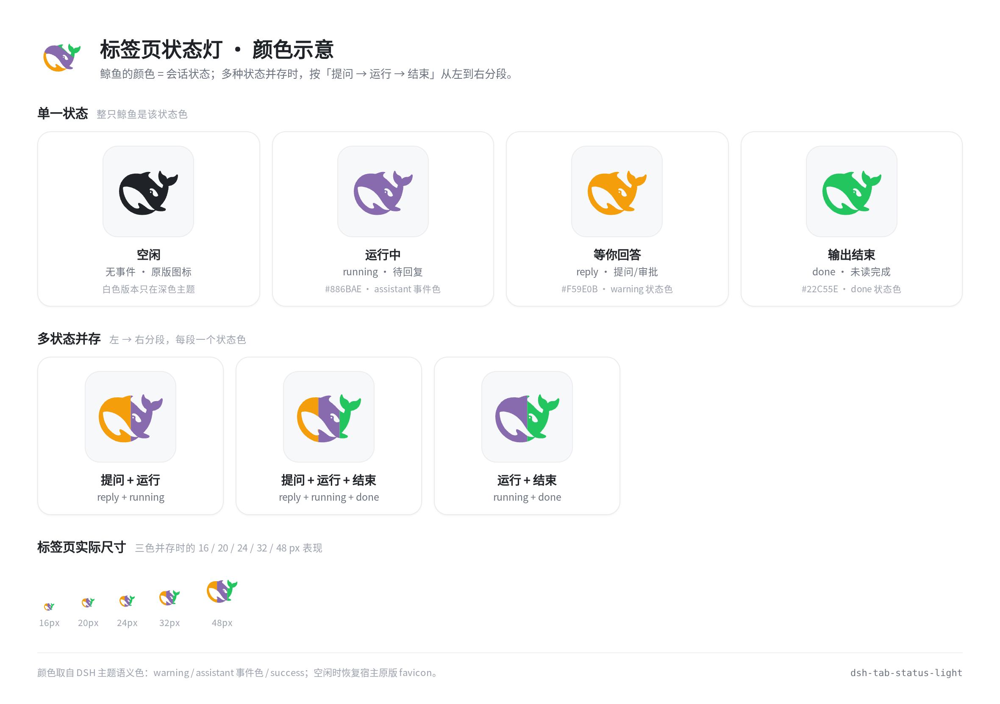
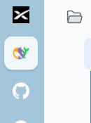
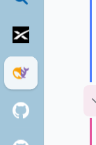

<p align="center">
  
</p>

<h1 align="center">DSH Tab Status Light</h1>

<p align="center">
  把 DSH 的浏览器标签页图标变成<strong>会话状态灯</strong>：
  <br>
  <strong>生成中紫罗兰 · 等你回答琥珀 · 输出结束绿色</strong>，多种状态并存时鲸鱼分段多色。
  <br>
  只换鲸鱼的填充色，标签背景保持浏览器自己的。
  <br><br>
  <code>v0.1.0</code> · DSH Web Plugin · MIT
</p>

<p align="center">
  <a href="#颜色示意">颜色示意</a> ·
  <a href="#实况">实况</a> ·
  <a href="#为什么">为什么</a> ·
  <a href="#状态与颜色">状态与颜色</a> ·
  <a href="#多状态并存">多状态并存</a> ·
  <a href="#绿色什么时候消失">绿色清空规则</a> ·
  <a href="#工作原理">工作原理</a> ·
  <a href="#安装">安装</a> ·
  <a href="#常见问题">FAQ</a> ·
  <a href="#灵感来源与致谢">灵感来源与致谢</a>
</p>

---

## 颜色示意

<p align="center">
  
</p>

<p align="center">
  <sub>鲸鱼的颜色 = 会话状态；多种状态并存时按「提问 → 运行 → 结束」从左到右分段。</sub>
</p>

## 实况

浏览器侧栏里的 DSH 图标会**实时变色**（实拍）：

| 三色并存 | 两色并存 |
| :---: | :---: |
|  |  |
| 提问 + 运行 + 结束 | 提问 + 运行 |

> 颜色语义取自 DSH 自己的主题色：`warning`（等你回答）、assistant 事件色（运行中）、
> `success`（输出结束）；刻意避开了 DeepSeek logo 的蓝色，免得和品牌图标混淆。

## 为什么

DSH 的会话跑起来以后，用户往往切去别的窗口，回来时不确定：

- 它还在跑吗？
- 是不是在等我回答某个问题 / 批准某个操作？
- 刚才那轮输出结束了吗？

浏览器标签页是最容易被余光扫到的地方，但网页不能修改标签页的背景色。所以这个插件把
**标签页 favicon 的鲸鱼**当作状态灯：

- 不打扰：不弹通知、不占界面空间，只是图标换色。
- 多状态并存：多个会话、多种状态同时存在时，鲸鱼按优先级分段上色。
- 无事件才“原色”：只有什么状态都没有时，才恢复宿主原版白/黑鲸鱼。

## 状态与颜色

| 状态 | 颜色 | 取自 DSH 哪里 | 什么时候出现 |
| --- | --- | --- | --- |
| `idle` | 原版图标（深色主题白鲸 / 浅色主题黑鲸） | 宿主自带 favicon | 没有任何会话在跑、也没有未读结束 |
| `running` | 紫罗兰 `#886BAE`（跟随主题解析） | 轨迹页 assistant 事件色 `.assistantVioletBright` = brand 60% + error-secondary 40% | 任一会话正在生成 / 等待模型回复（待回复） |
| `reply` | 琥珀 `#F59E0B` | 宿主 `StateDot` 的 `warning` 态 | 有 `ask_user_question` 提问或审批在等你 |
| `done` | 绿色 `#22C55E` | 宿主 `StateDot` 的 `done` 态 | 你在别的页面/应用时某个会话跑完；或后台会话有未读完成 |

> 同一个会话在等你回答时只算「询问」。DSH 在等待回答期间该会话的 `running` 仍为 true，
> 那是被暂停的同一个 Turn，不会同时点亮「运行」——否则一次提问会让鲸鱼变成两色。

## 多状态并存

多个状态同时活跃时，鲸鱼按 **左 → 右** 等分成色带（顺序固定为 `询问 → 运行 → 结束`）：

| 并存状态 | 标签页表现 |
| --- | --- |
| 只有 1 个 | 整只鲸鱼是该状态色 |
| 询问 + 运行 | 左琥珀 · 右紫罗兰 |
| 询问 + 运行 + 结束 | 左琥珀 · 中紫罗兰 · 右绿 |
| 运行 + 结束 | 左紫罗兰 · 右绿 |
| 无任何事件 | 原版白/黑鲸鱼（白色只在这种情况下出现） |

分段顺序在 `client.js` 的 `STATE_PRIORITY` 里，想改一处即可。

## 绿色什么时候消失

`done` 是最容易“赖着不走”的状态，这里的规则是明确的：

- **点开那个会话就算已读**：绿色立刻消失，不等宿主清未读。
- **切回标签页或任意页面交互**（点击 / 按键 / 聚焦）会清掉「离开时结束」的提醒。
- **其它真实会话的未读完成会保留**，直到你点开它们——这是“未读”本来的语义。
- **只统计你能点开的一级会话**：subagent / Agent Teams 队友会话被过滤掉。它们不能像普通
  会话那样被打开，如果算进来，它们的未读完成会把标签页永久钉在绿色（这是踩过的坑）。

## 工作原理

- **数据源**：`@deepseek-ai/dsh-client-ui-session` 提供给 root 槽位的 `useSessionStatus`
  选择器 hook（`SessionStatusSnapshot`）。它已经把每个会话的 `running` /
  `pendingInteraction` / `completionUnread` 折好了——不轮询、不读会话日志。
- **颜色**：每个状态一条 DSH 主题 token / 主题表达式（`STATUS_COLOR_SPECS`）+ 内置兜底色。
  用隐藏探针元素让浏览器把 `var()` / `color-mix()` 解析成具体颜色，因此明暗主题、自定义
  token 会自动跟随；`theme/change` 时重建图标。
- **图标**：只绘制鲸鱼 path（`viewBox="0 0 50 50"`），单色时整只填充，多色时用鲸鱼做剪切区
  画等宽竖条。Canvas 输出透明底 PNG，Canvas 不可用时退回透明底 SVG data URI。
- **接管 favicon**：标签页图标属于文档级 chrome，不能当槽位内容渲染。插件在
  `shell.overlay` 注册一个**不渲染任何内容**的组件，由它的 effect 接管
  `document.head` 的 `link[rel~="icon"]`（摘掉原始 link → 插入自己的 link；空闲/卸载时
  原样放回，若默认 link 已丢失还会自动补回）。
- **不碰**：`document.title`（归 ui-layout 的 `DocumentTitle`）和 `theme-color`
  （归 ui-layout 的主题控制器），避免互相覆盖。

## 安装

要求：DSH `>=0.2.1-rc.2 <0.3.0`（Web profile）。

**方式一：从 GitHub 安装（推荐）**

```
plugin_manager → install_bundle → target: github:xyzYaeMiko/dsh-tab-status-light
```

或使用 DSH CLI：

```bash
dsh plugin --profile web add github:xyzYaeMiko/dsh-tab-status-light
```

**方式二：本地开发安装**

```bash
git clone https://github.com/xyzYaeMiko/dsh-tab-status-light.git
# plugin_manager → install_bundle → target: /path/to/dsh-tab-status-light
```

装好后若页面没有自动生效，刷新一次 DSH 页面。卸载：插件列表里禁用/移除
`标签页状态灯`，图标立即恢复原版。

## 兼容性与已知限制

- 只换 favicon 的鲸鱼颜色，不改标签页标题文字、不画背景色块（浏览器也不允许网页改标签背景）。
- 同一个 DSH 打开多个标签页时，每个页面都会反映同一份会话状态，因此会一起变色。
- 颜色跟着主题 token 走；主题若删掉这些 token 会退回内置兜底色。
- 动态 favicon 依赖浏览器支持：Chromium 系最稳，Firefox / Safari 可能不刷新图标。
- 只统计一级会话；subagent / 队友会话不驱动标签页颜色（原因见上）。

## 开发

```bash
node --check client.js                     # 语法
node test/logic.test.mjs                   # 状态折叠 / 颜色键 / 会话作用域
node test/favicon-controller.test.mjs      # 多色图形 / favicon link 恢复回归
```

`docs/colors.png` 与 `docs/design/` 是设计存档（示意图与图标候选），已随仓库提交。

目录结构：

```
.
├── client.js              # 浏览器半：状态折叠、配色、favicon 接管
├── index.js               # Host 半（空，占位）
├── cordis.patch.yml       # bundle 挂载声明
├── icon.svg               # 插件列表图标
├── locale/                # 插件标题 / 描述
├── test/                  # 纯函数 + fake-DOM 回归测试
└── docs/                  # README 截图、颜色示意图、图标设计存档
```

## 常见问题

**Q：刷新页面后图标没变？**
检查插件是否已启用（设置 → 插件）；动态 favicon 在 Chromium 上最可靠。

**Q：为什么改 favicon 而不是标签标题或背景色？**
网页不能改浏览器标签背景色；`document.title` 归宿主组件所有，抢它容易互相覆盖。
favicon 是唯一稳定、无争议、又不占界面空间的状态位。

**Q：为什么「运行中」是紫色而不是蓝色？**
蓝色是 DeepSeek logo 的品牌蓝（`#4D6BFE` 一带），拿它当状态色会和产品图标混在一起，
看起来像换了品牌图标而不是「正在运行」——一开始确实用过蓝色，和 logo 太像了。
紫色取自 DSH 轨迹页的 assistant 事件色（`.assistantVioletBright` = brand 60% + error-secondary 40%），
语义就是「助手正在生成」，和 logo 蓝区分明显。琥珀（等你回答）和绿（输出结束）同样来自宿主
`StateDot` 的 `warning` / `success` 语义色。

**Q：会和其他插件冲突吗？**
只接管 `link[rel~="icon"]`，卸载时原样恢复；不碰标题、`theme-color`、`document.body`。

## 灵感来源与致谢

最初的灵感来自 B 站上「把 AI 工作状态外化成图标颜色」这类插件：一眼扫到状态这个点子很好，
后来想再找当时的那个插件没找到，索性自己实现了一个。

感谢这些 B 站 UP 主愿意把「状态灯」式的想法做成视频分享出来——很多巧思都是从社区里学来的；
也感谢 DSH 开源社区与宿主 UI 的主题 / 状态语义色，让这个插件能沿用原版配色而不是自造一套。

## 许可与素材来源

- 代码：MIT（见 [`LICENSE`](LICENSE)）。
- 鲸鱼 path 来自 `@deepseek-ai/dsh-web-frontend` 自带的 `dist/favicon.svg`（MIT），
  只改填充色，未改动轮廓，也不加背景（见 [`NOTICE.md`](NOTICE.md)）。
- 状态/事件配色语义来自宿主：`@deepseek-ai/dsh-client-ui-trajectory` 的 assistant 事件色、
  `@deepseek-ai/dsh-client-ui-primitives` 的 `StateDot` warning/done，以及
  `@deepseek-ai/dsh-client-ui-theme` 的主题 token 定义。
- 插件列表图标 `icon.svg`：斜切三色鲸鱼，构图原创、轮廓复用同一份 MIT 素材。
